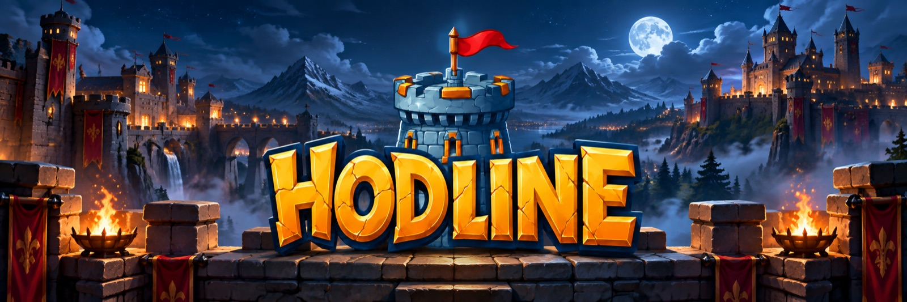
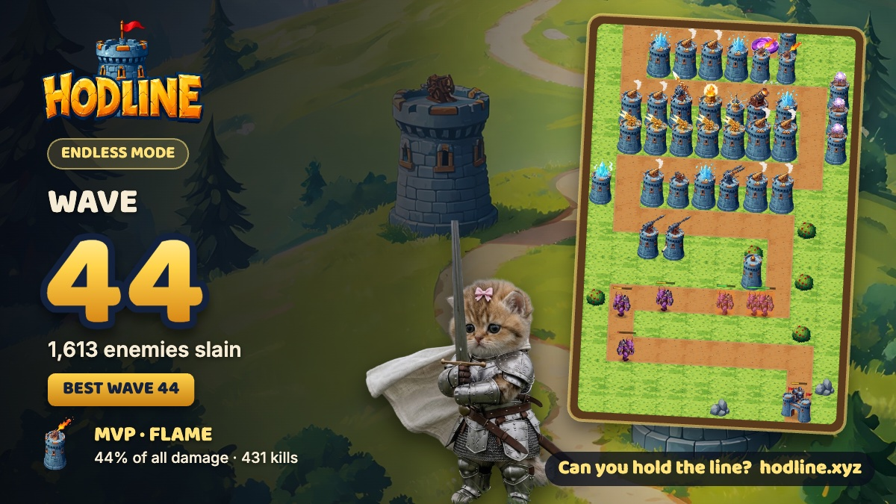
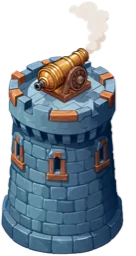
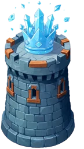
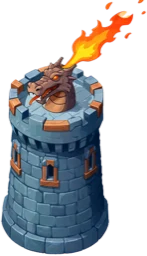
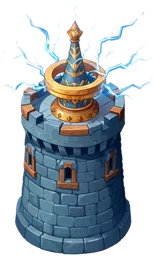
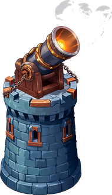
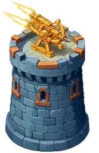
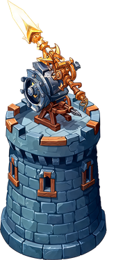
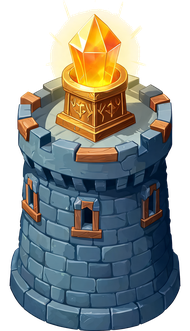

<p align="center">
  <a href="https://hodline.xyz"></a>
</p>

<h3 align="center">Hold the line. Every score proven.</h3>

<p align="center">
  The deterministic engine behind <a href="https://hodline.xyz"><b>Hodline</b></a>, a browser tower-defense game on Robinhood Chain,<br>
  and the replay that re-plays every run before it reaches the leaderboard.
</p>

<p align="center">
  <a href="https://hodline.xyz"></a>
  
  <a href="https://x.com/hodlinexyz"></a>
</p>

---

## The game

Build towers along the path, upgrade them, and hold off endless waves of grunts, runners, brutes, armored knights and bosses. Every 10th wave brings a boss.

<p align="center">
  
</p>

| Mode | What it is |
|---|---|
| **Endless** | Waves never stop. Towers go up to tier 5. How far can you get? |
| **Campaign** | Hand-built levels with a fixed number of waves. |
| **Daily Map** | One free map a day, the same for everyone. Players fight for the Robinhood Chain coin they hold, so coins compete as teams. |
| **Season** | One map for a week. Token projects sponsor the prize pool, and the top players are paid on-chain. |
| **Duels** | 1v1 on the same seed, with a token prize and a shareable link. |

### Eight towers

<table align="center">
  <tr>
    <td align="center"><br><b>Cannon</b><br><sub>Splash damage</sub></td>
    <td align="center"><br><b>Frost</b><br><sub>Slows everything</sub></td>
    <td align="center"><br><b>Flame</b><br><sub>Burns, burning foes explode</sub></td>
    <td align="center"><br><b>Tesla</b><br><sub>Chain lightning</sub></td>
  </tr>
  <tr>
    <td align="center"><br><b>Mortar</b><br><sub>Long range, cracks armour</sub></td>
    <td align="center"><br><b>Ballista</b><br><sub>Long-range single target</sub></td>
    <td align="center"><br><b>Lance</b><br><sub>Pierces armour</sub></td>
    <td align="center"><br><b>Beacon</b><br><sub>Buffs towers around it</sub></td>
  </tr>
</table>

Towers combine: frost makes tesla hit 50% harder, mortar shells crack armour, and flame kills set off chain explosions.

---

## Why this repo is public

Hodline pays token prizes for leaderboard scores, so the scores have to be trustworthy. A browser can send any number it likes, so the server never takes a score at face value.

```
 player's browser                         Hodline server
 ┌───────────────────────┐                ┌─────────────────────────────┐
 │ plays the game        │   inputs only  │ same engine, same seed      │
 │ records each input    │ ─────────────▶ │ re-plays every input        │
 │ (place, upgrade, sell,│   + seed       │ keeps the wave/kills IT got │
 │  target, call wave)   │                │ rejects impossible moves    │
 └───────────────────────┘                └─────────────────────────────┘
```

The game records the player's **inputs**, not a score: each tower placed, upgraded, sold or retargeted, and each wave called, with the tick it happened on. The server runs those inputs through this same engine and keeps the result the engine produces. If a record asks for a move the game would not allow, such as building on the path or spending gold the player does not have, the replay rejects it.

This repo is that engine: the exact code the site plays and the server replays.

## What makes it deterministic

- **One seeded random stream.** Everything that can change the outcome draws from a seeded SplitMix64 generator in `src/game/rng.ts`. Cosmetic effects (sparks, puffs) stay off that stream, so drawing one more spark never shifts a gameplay roll.
- **Fixed ticks.** The simulation steps at 60 ticks per second regardless of frame rate. Playing at 1x or 5x gives the same result.
- **Portable math.** The simulation only uses operations IEEE-754 rounds exactly (`+ - * /`, `sqrt`) and its own helpers in place of `Math.pow` or `Math.hypot`, which can differ between engines. The same run comes out the same on a phone and on the server.
- **One implementation.** The server has no second copy of the rules. It bundles `src/game/replay.ts` from this code, so the two cannot drift apart.

## Verify a run yourself

```bash
npm install
npm run verify
```

This replays `examples/endless-wave-51.json`, a real wave-51 Endless run (166 inputs, about 28 minutes of play), in under a second:

```
wave     51
kills    1940
rejected 0
score    52940
OK: every action replayed cleanly
```

To check any other record:

```bash
node verify.mjs path/to/record.json
```

## Layout

| File | What it is |
|---|---|
| `src/game/engine.ts` | The simulation: towers, enemies, waves, combos, gold, lives, and the input recorder |
| `src/game/config.ts` | Tower and enemy stats, wave plans, tuning |
| `src/game/map.ts`, `levels.ts` | Map generation and the campaign levels |
| `src/game/rng.ts` | The seeded random stream and deterministic math helpers |
| `src/game/replay.ts` | Rebuilds a run from its record and reports wave, kills and rejected inputs |
| `src/game/art.ts`, `sfx.ts`, `progress.ts` | Drawing, sound and local progress. These are browser-only and never affect the outcome. |
| `verify.mjs` | Command-line wrapper around the replay |

## License

Published for transparency and review. Copyright © 2026 Hodline. All rights reserved. The rest of Hodline (site, server, payouts) is not open source.

<p align="center"><b><a href="https://hodline.xyz">Can you hold the line?</a></b></p>
